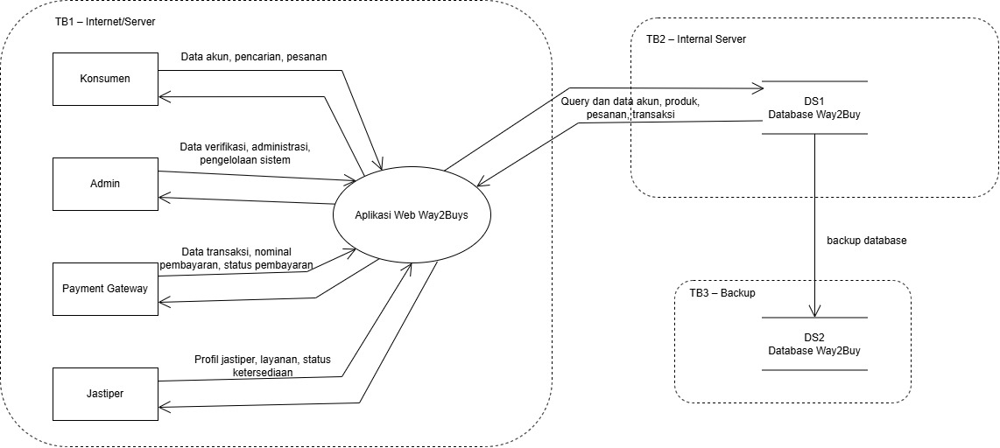

# 2. Data Flow Diagram dan Trust Boundary

Data Flow Diagram (DFD) digunakan untuk menggambarkan aliran data dalam sistem secara visual. Dalam konteks keamanan, DFD membantu mengidentifikasi di mana data mengalir, siapa yang mengakses data, serta di mana batas kepercayaan (trust boundary) berada. Informasi ini sangat penting sebagai dasar untuk mengidentifikasi potensi ancaman pada setiap titik aliran data dalam sistem Way2Buy.

---

## 2.1 Komponen DFD

Komponen DFD terdiri dari empat elemen utama, yaitu **External Entity** (entitas luar yang berinteraksi dengan sistem), **Process** (proses yang mengolah data), **Data Store** (tempat penyimpanan data), dan **Data Flow** (aliran data antar komponen). Berikut adalah komponen-komponen yang terdapat dalam sistem Way2Buy:

| ID  | Jenis           | Nama                    | Keterangan                                            |
| --- | --------------- | ----------------------- | ----------------------------------------------------- |
| C   | External Entity | Konsumen                | Pengguna yang mencari dan melakukan pemesanan jastip. |
| J   | External Entity | Jastiper                | Pengguna yang menyediakan layanan jastip.             |
| A   | External Entity | Admin                   | Pengelola dan administrator sistem.                   |
| PG  | External Entity | Payment Gateway         | Layanan eksternal untuk memproses pembayaran.         |
| P1  | Process         | Way2Buy Web Application | Aplikasi utama Way2Buy.                               |
| DS1 | Data Store      | Way2Buy Database        | Penyimpanan data aplikasi.                            |
| P2  | Process         | Backup Process          | Proses pembuatan backup database.                     |
| DS2 | Data Store      | Backup Storage          | Tempat penyimpanan backup.                            |

---

## 2.2 Trust Boundary

Trust Boundary (batas kepercayaan) merupakan garis pemisah antara komponen yang memiliki tingkat kepercayaan berbeda. Data yang melewati trust boundary berpotensi lebih besar untuk dimanipulasi atau disadap karena berpindah dari zona kepercayaan yang satu ke zona yang lain. Oleh karena itu, setiap data yang melewati trust boundary memerlukan kontrol keamanan tambahan seperti enkripsi, autentikasi, dan validasi.

| ID  | Trust Boundary            | Penjelasan                                                            |
| --- | ------------------------- | --------------------------------------------------------------------- |
| TB1 | Internet ↔ Server Way2Buy | Memisahkan pengguna/layanan eksternal dengan server aplikasi Way2Buy. |
| TB2 | Application ↔ Database    | Memisahkan aplikasi dengan database yang menyimpan data penting.      |
| TB3 | Server ↔ Backup Storage   | Memisahkan server utama dengan media penyimpanan backup.              |

---

## 2.3 Data Flow

Data Flow menggambarkan aliran data antar komponen dalam sistem. Setiap data flow diidentifikasi berdasarkan sumber, tujuan, jenis data yang mengalir, dan mekanisme keamanan yang diterapkan. Pemahaman terhadap data flow sangat penting untuk mengidentifikasi titik-titik rawan yang dapat dieksploitasi oleh penyerang.

| ID  | Sumber   | Tujuan          | Data Flow                                             | Keamanan                                           |
| --- | -------- | --------------- | ----------------------------------------------------- | -------------------------------------------------- |
| F1  | Konsumen | P1              | Data akun, pencarian, pesanan                         | HTTPS/TLS                                          |
| F2  | Jastiper | P1              | Profil jastiper, layanan, status ketersediaan         | HTTPS/TLS                                          |
| F3  | Admin    | P1              | Data verifikasi, administrasi, pengelolaan sistem     | HTTPS/TLS                                          |
| F4  | P1       | Payment Gateway | Data transaksi, nominal pembayaran, status pembayaran | HTTPS/TLS/API authentication                       |
| F5  | P1 ↔ DS1 | Database        | Query dan data akun, produk, pesanan, transaksi       | Authentication, authorization, parameterized query |
| F6  | P2       | DS2             | Dump/backup database                                  | Encryption at rest dan access control              |

---

## 2.4 DFD

Berikut merupakan Data Flow Diagram (DFD) sistem Way2Buy yang menggambarkan secara visual hubungan antara seluruh komponen sistem. Diagram ini menunjukkan bagaimana konsumen, jastiper, dan admin berinteraksi dengan aplikasi Way2Buy, serta bagaimana aplikasi berkomunikasi dengan database, payment gateway, dan backup storage. Trust boundary digambarkan dengan garis putus-putus yang memisahkan zona-zona dengan tingkat kepercayaan yang berbeda.

