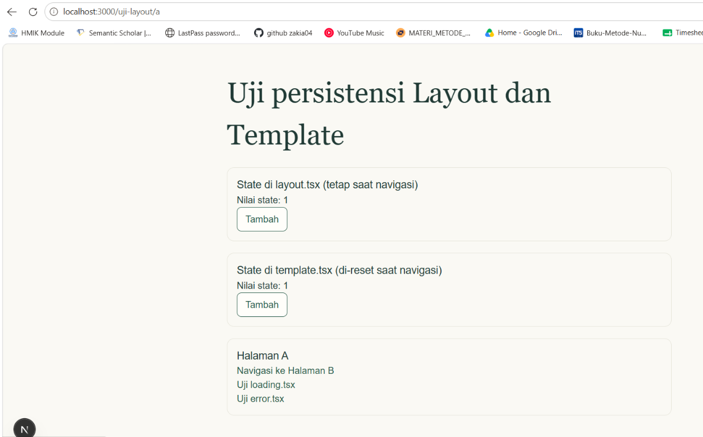
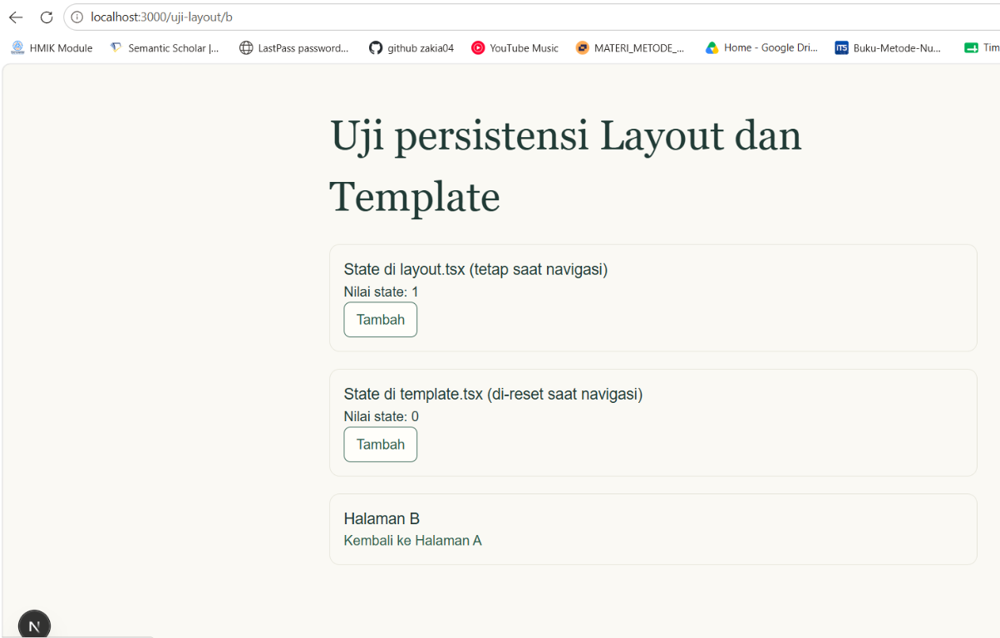
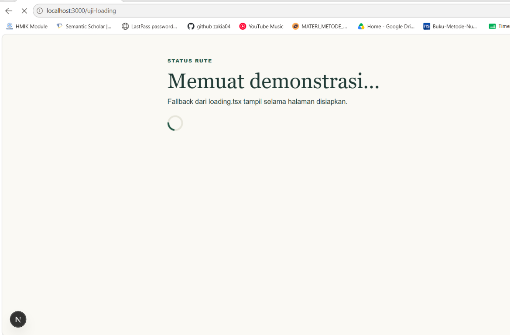
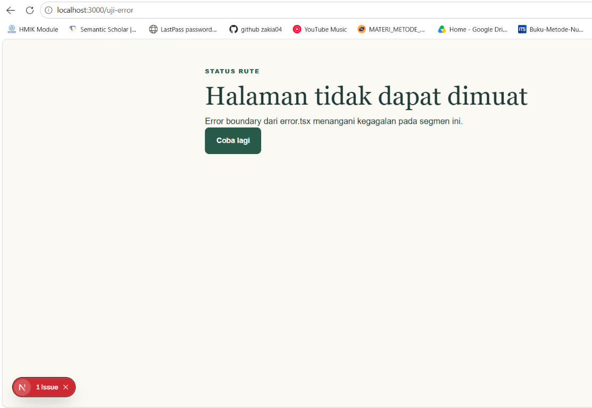
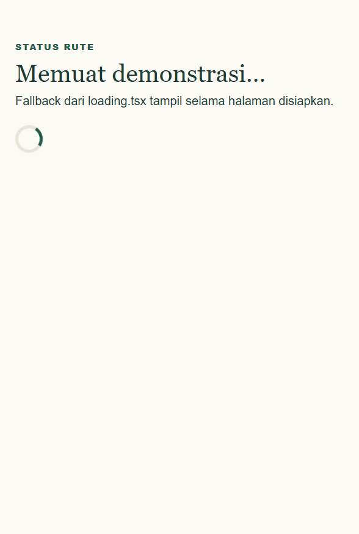
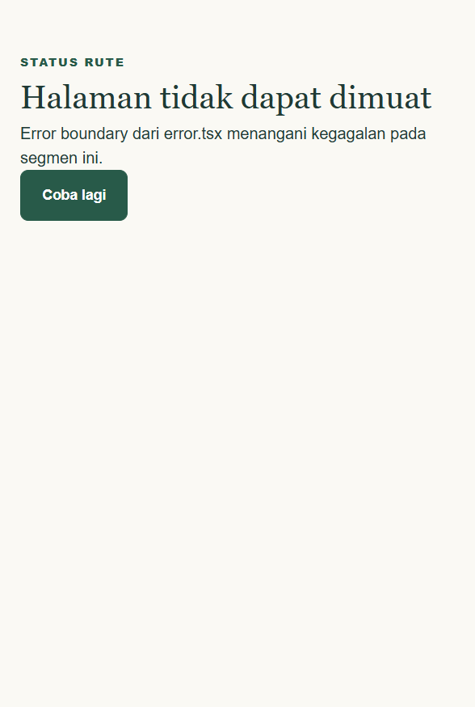

# Dokumen Teknis Modul 4: Next.js App Router

**Nama/NIM:** Zakiati Latifa / 105224033  
**Repositori:** [zakia04/105224033_Way2Buy](https://github.com/zakia04/105224033_Way2Buy)  
**Versi Next.js:** 16.4.0  
**Cache Components:** Aktif (`cacheComponents: true` di `next.config.ts`)  
**Tanggal verifikasi:** 21 Oktober 2026

Laporan ini mengikuti instruksi Tugas Pendahuluan Modul 4 Praktikum
Pemrograman Web. URL uji lokal menggunakan `127.0.0.1`.

## 1. Peta Rute

Peta rute utama di bawah mengikuti rute yang diminta pada Modul 4. Rute uji dan
API yang juga ada di proyek dicantumkan terpisah setelah tabel utama.

| URL | Berkas di `app/` | Jenis rute | Isi halaman |
| --- | --- | --- | --- |
| `/` | `app/page.tsx` | Statis | Halaman beranda yang memperkenalkan layanan Way2Buy. |
| `/produk` | `app/produk/page.tsx` | Statis | Katalog produk dengan pencarian dan filter kategori. |
| `/produk/[id]` | `app/produk/[id]/page.tsx` | Dinamis | Detail produk berdasarkan ID, termasuk nama, harga, kategori, dan deskripsi. |
| `/tentang` | `app/tentang/page.tsx` | Statis | Tujuan Way2Buy, masalah yang diselesaikan, dan fitur utama layanan. |
| `/titip` | `app/titip/page.tsx` | Statis | Formulir permintaan jasa titip dari pengguna. |

Rute tambahan untuk demonstrasi serta API:

| URL | Berkas di `app/` | Jenis rute | Isi |
| --- | --- | --- | --- |
| `/uji-layout/a`, `/uji-layout/b` | `app/uji-layout/{a,b}/page.tsx` | Statis | Demonstrasi persistensi state antara layout dan template. |
| `/uji-loading` | `app/uji-loading/page.tsx` | Streaming | Halaman yang menunggu enam detik untuk memperlihatkan `loading.tsx`. |
| `/uji-error` | `app/uji-error/page.tsx` | Streaming | Melempar error demonstrasi yang ditangani oleh `error.tsx`. |
| `/api/crypto` | `app/api/crypto/route.ts` | Route Handler dinamis | Operasi API enkripsi/dekripsi alamat. |
| `/api/orders` | `app/api/orders/route.ts` | Route Handler dinamis | Menerima permintaan pesanan. |

`app/produk/[id]/not-found.tsx` merender tampilan produk tidak ditemukan.
`proxy.ts` berada di root proyek (di luar `app/`) dan memeriksa ID sebelum
render agar URL produk yang tidak valid mendapat status HTTP 404.

Potongan `Route (app)` dari `npm run build`:

```text
Route (app)
┌ ○ /
├ ○ /_not-found
├ ƒ /api/crypto
├ ƒ /api/orders
├ ○ /produk
├   /produk/[id]
│ ├ ◐ /produk/[id]
│ ├ ○ /produk/P001
│ ├ ○ /produk/P002
│ └ ◐ [+4 more paths]
├ ○ /tentang
├ ○ /titip
├ ◐ /uji-error
├ ○ /uji-layout/a
├ ○ /uji-layout/b
└ ◐ /uji-loading

ƒ Proxy (Middleware)

○  (Static)             prerendered as static content
◐  (Partial Prerender)  prerendered as static HTML with dynamic server-streamed content
ƒ  (Dynamic)            server-rendered on demand
```

## 2. Layout, Template, dan Berkas Khusus

### Pohon folder `app/` akhir

```text
app/
├── api/
│   ├── crypto/route.ts
│   └── orders/route.ts
├── produk/
│   ├── [id]/
│   │   ├── not-found.tsx
│   │   └── page.tsx
│   └── page.tsx
├── titip/page.tsx
├── tentang/page.tsx
├── uji-error/
│   ├── error.tsx
│   └── page.tsx
├── uji-layout/
│   ├── a/page.tsx
│   ├── b/page.tsx
│   ├── layout.tsx
│   └── template.tsx
├── uji-loading/
│   ├── loading.tsx
│   └── page.tsx
├── favicon.ico
├── globals.css
├── layout.tsx
└── page.tsx
```

Komponen halaman diletakkan di `components/features/` dan komponen bersama di
`components/layout/`, di luar direktori route. Data produk berada di
`lib/catalog/products.ts`. Ini mempertahankan pemisahan antara berkas route
Next.js dan komponen/domain; nama serta lokasi data berbeda dari contoh Modul 4
(`app/data/products.ts`), tetapi fungsi sebagai sumber ID produk tetap sama.
Berikut bagian struktur fitur di luar `app/`:

```text
components/
├── features/
│   ├── about/AboutPage.tsx
│   ├── home/HomePage.tsx
│   ├── products/
│   │   ├── ProductArtwork.tsx
│   │   ├── ProductCard.tsx
│   │   ├── ProductCatalog.tsx
│   │   ├── ProductDetail.tsx
│   │   └── ProductsPage.tsx
│   ├── requests/
│   │   ├── RequestForm.tsx
│   │   └── RequestPage.tsx
│   └── diagnostics/RouteLifecycleProbe.tsx
└── layout/
    ├── AuthModal.tsx
    ├── SiteFooter.tsx
    └── SiteHeader.tsx

lib/
├── catalog/products.ts
└── data.ts
```

`app/layout.tsx` adalah root layout yang membungkus aplikasi. `layout.tsx` dan
`template.tsx` di `uji-layout` sengaja dibatasi ke rute demonstrasi, agar uji
remount tidak mengubah perilaku halaman Way2Buy lainnya. Pada gambar yang
dilampirkan, state layout bertahan pada `1`, sedangkan state template berubah
dari `1` menjadi `0`. Pada sesi verifikasi terpisah, state layout juga terbukti
bertahan (`6`) dan template di-reset (`4` menjadi `0`).

| Bukti | Mode | Hasil |
| --- | --- | --- |
| Halaman A sebelum navigasi | Dev | State layout dan template masing-masing `1`. |
| Halaman B sesudah navigasi | Dev | State layout tetap `1`; state template di-reset menjadi `0`. |
| `loading.tsx` | Dev | Fallback tampil ketika halaman disiapkan. |
| `error.tsx` | Dev | Error boundary menangani kegagalan demonstrasi. |
| `loading.tsx` | Production | Fallback tampil selama halaman demonstrasi menunggu. |
| `error.tsx` | Production | Error boundary tampil tanpa overlay development. |

**Bukti dari Modul 4 — layout/template sebelum navigasi (Halaman A):**



**Bukti dari Modul 4 — sesudah navigasi (Halaman B):**



**Bukti dari Modul 4 — tampilan `loading.tsx` pada mode development:**



**Bukti dari Modul 4 — tampilan `error.tsx` pada mode development:**



**Verifikasi tambahan — fallback loading pada mode production:**



**Verifikasi tambahan — error boundary pada mode production:**



Demo dapat dibuka dengan `npm run dev` atau `npm run build && npm run start`,
lalu kunjungi `/uji-layout/a`. Tautan di halaman itu membuka demonstrasi
`loading.tsx` dan `error.tsx`.

## 3. Rute Dinamis dan Validasi `params`

Rute dinamis yang digunakan adalah `/produk/[id]`. Pada Next.js 16, `params`
diterima sebagai `Promise<{ id: string }>` dan harus di-`await`. Data contoh
Modul 4 menggunakan `app/data/products.ts`; dalam implementasi ini data katalog
yang sama fungsinya berada di `lib/catalog/products.ts`.

Aturan validasi ID:

1. ID harus mengikuti pola tepat `P` kapital diikuti tiga angka (`^P\d{3}$`),
   contohnya `P001`.
2. Setelah pola cocok, ID juga harus ada pada data produk. ID yang formatnya
   benar namun tidak terdaftar tetap tidak valid.
3. `generateStaticParams()` membuat jalur untuk setiap produk dalam katalog.
4. Karakter URL yang di-encode diuji setelah dikirim melalui HTTP; karakter
   yang didekode tetap harus memenuhi pola ID.
5. `lib/data.ts` memvalidasi format dan mencari data pada server. Segmen
   `not-found.tsx` menyediakan tampilan untuk produk yang tidak ditemukan.
6. `proxy.ts` mengirim status 404 sebelum streaming untuk format atau ID yang
   tidak dikenal; status ini diverifikasi dengan `curl.exe`.

Tabel hasil `curl.exe -s -o NUL -w "%{http_code}"` terhadap production lokal:

| URL dari Modul 4 | Hasil yang diharapkan | Hasil aktual | Kode status |
| --- | --- | --- | ---: |
| `/produk/P001` | Sah jika ID tersedia; halaman detail ditampilkan. | Detail Keripik Sanjai Balado tampil. | 200 |
| `/produk/P%3F01` | Tidak sah; tanda `?` setelah decode ditolak. | Respons produk tidak ditemukan. | 404 |
| `/produk/P+001` | Tidak sah; tanda `+` ditolak. | Respons produk tidak ditemukan. | 404 |
| `/produk/P%20001` | Tidak sah; spasi setelah decode ditolak. | Respons produk tidak ditemukan. | 404 |
| `/produk/P999` | Tidak sah; format benar, ID tidak ada di katalog. | Respons produk tidak ditemukan. | 404 |

```text
200 http://127.0.0.1:3101/produk/P001
404 http://127.0.0.1:3101/produk/P%3F01
404 http://127.0.0.1:3101/produk/P+001
404 http://127.0.0.1:3101/produk/P%20001
404 http://127.0.0.1:3101/produk/P999
```

Pengujian karakter ter-encode menggunakan `curl.exe --path-as-is` agar path
persis seperti contoh modul dikirim ke server.

## 4. Pembagian Server dan Client Components

| Komponen/berkas | Jenis | Alasan teknis |
| --- | --- | --- |
| `app/layout.tsx`, `app/page.tsx`, `app/produk/page.tsx`, `app/produk/[id]/page.tsx`, `app/tentang/page.tsx`, `app/titip/page.tsx` | Server | Default App Router; merender halaman, metadata, route params, dan data. |
| `components/features/home/HomePage.tsx`, `about/AboutPage.tsx`, `products/ProductsPage.tsx`, `products/ProductDetail.tsx`, `requests/RequestPage.tsx` | Server | Tidak memerlukan state/event browser; menggabungkan konten dan komponen fitur. |
| `components/layout/SiteFooter.tsx`, `components/features/products/ProductArtwork.tsx` | Server | Presentasi tanpa state interaktif. |
| `components/layout/SiteHeader.tsx`, `components/layout/AuthModal.tsx` | Client | Memakai state, event handler, serta modal interaktif. |
| `components/features/products/ProductCatalog.tsx` | Client | Pencarian/filter berubah langsung berdasarkan input dan state pengguna. |
| `components/features/requests/RequestForm.tsx` | Client | Validasi form, state input, dan pengiriman event/API. |
| `components/features/diagnostics/RouteLifecycleProbe.tsx` | Client | Menyimpan counter React untuk membuktikan siklus hidup layout/template. |
| `app/uji-error/error.tsx` | Client | Error boundary App Router harus Client Component; menerima `reset()` untuk mencoba render ulang. |
| `lib/data.ts` | Server-only | Mengimpor `server-only` dan memusatkan pencarian produk yang hanya dipakai route server. |
| `lib/catalog/products.ts` | Isomorphic | Data katalog dipakai route server dan katalog Client Component; tidak mengimpor API server-only. |

Uji negatif mengimpor `getProductById` dari `lib/data.ts` ke komponen dengan
`"use client"`, lalu menjalankan `npx next build`. Build menolak impor tersebut:

```text
Error: 'server-only' cannot be imported from a Client Component module
It should only be used from a Server Component.
```

Jejak impor menunjukkan `lib/data.ts` masuk ke bundle `Client Component Browser`
dan `Client Component SSR`. Berkas uji sementara kemudian dihapus; kode aplikasi
tidak menyimpan impor yang melanggar batas Server/Client.

## 5. Verifikasi

### TypeScript

Perintah `npx tsc --noEmit` selesai dengan exit code `0` dan tanpa diagnostik.

### ESLint

`npm run lint` berhasil dijalankan setelah berkas paket `es-abstract` yang
hilang dipulihkan di `node_modules`. Temuan lint diperbaiki: modal autentikasi
kini dirender kondisional agar state diinisialisasi saat dibuka (tanpa
`setState` sinkron di dalam effect), dan tiga import yang tidak digunakan
dihapus dari tes:

```text
npm run lint
# selesai dengan exit code 0, tanpa error atau warning
```

Dengan demikian, status `npm run lint` adalah **lulus**.

### Build

Perintah `npm run build` selesai dengan exit code `0`. Keluaran route yang
relevan dicantumkan pada Bagian 1; build menghasilkan enam jalur produk dari
`generateStaticParams()` dan route demonstrasi untuk layout/template/loading/error.

### Uji Server-only

Build dengan fixture Client Component yang sengaja mengimpor `lib/data.ts`
gagal sebagaimana diharapkan dengan pesan bahwa `server-only` tidak boleh
diimpor dari Client Component. Fixture dihapus, lalu build normal kembali
berhasil.

## 6. Kendala dan Penyelesaian

1. **`npm run lint` awal tidak dapat memuat `es-abstract/2024/AddEntriesFromIterable`.**
   Instalasi lokal memiliki paket `es-abstract` yang tidak lengkap. `npm ci`
   juga menolak karena `package.json` dan lockfile yang sudah ada tidak sinkron
   (antara lain entri `tsx@4.23.15` dan `esbuild@0.28.2` tidak tercatat di lock).
   Berkas paket lokal dipulihkan tanpa mengubah manifest atau lockfile,
   kemudian temuan lint diperbaiki: modal autentikasi di-mount hanya saat dibuka
   dan import tes yang tidak digunakan dihapus. Verifikasi terakhir `npm run
   lint` lulus tanpa error maupun warning.
2. **`dynamicParams = false` tidak didukung dengan `cacheComponents: true`.**
   Build menolak konfigurasi route tersebut. Validasi format dan keanggotaan ID
   katalog dipindahkan ke `proxy.ts`, yang mengirim status 404 sebelum render;
   pengujian curl terhadap seluruh URL contoh Modul 4 mengonfirmasi hasilnya.
3. **`connection()` untuk error demo tidak dapat berada di luar Suspense pada
   saat prerender.** Build pertama gagal dengan pesan bahwa data runtime
   menghalangi prerender. Pemanggilan dipindahkan ke komponen async di dalam
   `<Suspense>`, setelah itu build berhasil dan `error.tsx` tetap dapat diuji.
4. **Uji impor `server-only` harus menghasilkan build gagal.** Kegagalan tersebut
   adalah hasil yang diharapkan, bukan regresi aplikasi. Fixture sementara
   dihapus dan build produksi normal dijalankan ulang dengan sukses.

## 7. Catatan Pemanfaatan AI

- **Alat:** AI assistant menggunakan Copilot SDK di VS Code.
- **Bagian yang dibantu:** pemeriksaan kecocokan laporan dengan instruksi Modul
  4, penyusunan/revisi dokumentasi, implementasi halaman `/tentang` dan
  fallback `not-found.tsx`, serta pembaruan validasi dan bukti rute.
- **Cara memverifikasi hasil:** isi laporan dicocokkan dengan instruksi PDF
  Modul 4 dan source code; `npx tsc --noEmit`, `npm run lint`, `npm run build`,
  dan `npm test` dijalankan; status route diperiksa menggunakan `curl.exe`;
  gambar layar diperiksa agar sesuai dengan hasil aplikasi.
- **Tanggung jawab akhir:** penulis memeriksa dan bertanggung jawab atas
  perubahan kode, hasil pengujian, gambar, dan isi laporan.
