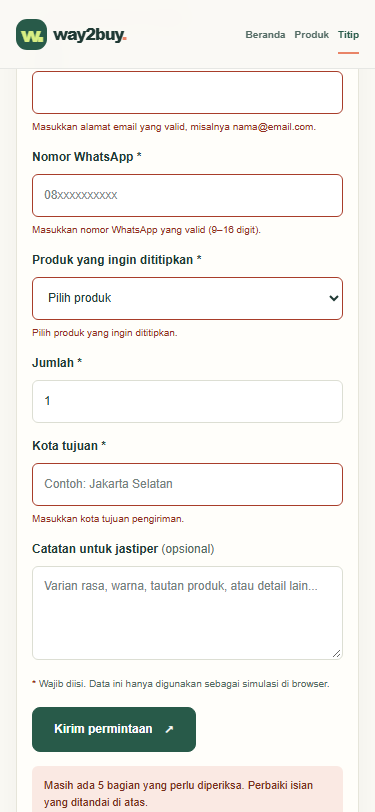

# Dokumen Praktikum Modul 5: Validasi Form dan Session

## 1. Skema Validasi

Skema bersama berada di `lib/schema/order.schema.ts`. Formulir memakainya di
browser dan Route Handler memvalidasi ulang data yang diterima server.

| Kolom formulir | Aturan Zod | Pesan galat |
| --- | --- | --- |
| Nama lengkap (`name`) | String di-trim, minimal 2 karakter. | `Nama minimal terdiri dari 2 karakter.` |
| Email (`email`) | String di-trim dan harus berformat email. | `Masukkan alamat email yang valid, misalnya nama@email.com.` |
| Nomor WhatsApp (`phone`) | Hanya angka, `+`, tanda kurung, tanda hubung, atau spasi; setelah karakter nonangka dibuang, jumlah digit harus 9–16. | `Masukkan nomor WhatsApp yang valid.` atau `Masukkan nomor WhatsApp yang valid (9–16 digit).` |
| Produk (`product`) | Wajib dipilih; nilainya harus `custom` atau ID yang ada di katalog. | `Pilih produk yang ingin dititipkan.` atau `Produk yang dipilih tidak tersedia.` |
| Jumlah (`quantity`) | String bilangan bulat; harus berupa safe integer dan nilainya minimal 1. | `Jumlah harus berupa bilangan bulat.` atau `Jumlah minimal 1.` |
| Kota tujuan (`destination`) | String di-trim, minimal 3 karakter. | `Masukkan kota tujuan pengiriman.` |
| Catatan (`notes`) | String; opsional untuk produk katalog. Jika produk `custom`, hasil trim harus minimal 4 karakter. | Untuk produk `custom`: `Jelaskan produk yang ingin dititipkan (minimal 4 karakter).` |

### Aturan semantik yang diperiksa server

Aturan berikut ada dalam skema bersama dan dijalankan kembali di server, bukan
di sebuah Server Action:

| Aturan | Alasan |
| --- | --- |
| Produk harus `custom` atau ID produk yang benar-benar ada di katalog. | Nilai pilihan dari browser dapat diubah; server tidak boleh menerima produk yang tidak tersedia. |
| Produk `custom` harus memiliki catatan minimal 4 karakter setelah trim. | Server perlu menerima deskripsi yang cukup untuk mengidentifikasi produk di luar katalog. |
| Jumlah harus integer aman dan minimal 1. | Mencegah jumlah nol, negatif, pecahan, atau nilai di luar rentang integer aman. |

## 2. Alur Server Action dan Pembagian Berkas

### Alur aktual

Saat ini alurnya **bukan Server Action**:

1. `components/features/requests/RequestForm.tsx` menerima submit formulir.
2. `noValidate` mematikan validasi bawaan browser. Handler React tetap
   menjalankan `orderSchema.safeParse(values)` dan menampilkan galat pada
   kolom yang sesuai.
3. Jika validasi klien lolos, komponen mengirim JSON ke `POST /api/orders`.
4. `app/api/orders/route.ts` memvalidasi ulang body dengan skema yang sama.
   Body yang tidak valid mendapat status `400` beserta galat dan daftar issue.
5. Untuk input valid, Route Handler mengenkripsi alamat tujuan dengan
   AES-256-GCM, membuat ID sintetis, lalu mengirim respons JSON.
6. Route Handler saat ini tidak menyimpan pesanan ke basis data. Tidak ada
   `revalidatePath()` atau `redirect()`; UI menampilkan hasil dari respons API.

### Urutan Server Action yang disarankan, jika alur ini dipindahkan ke Action

Urutan berikut adalah rancangan, **bukan perilaku yang sudah diterapkan atau
diuji**:

1. Baca session dari cookie dan verifikasi session di server.
2. Parse `FormData`, lalu jalankan validasi bentuk dengan Zod.
3. Jalankan pemeriksaan semantik yang bergantung pada data server, termasuk
   keanggotaan produk di katalog dan aturan produk `custom`.
4. Jika lolos, lakukan mutasi persisten (misalnya menyimpan pesanan).
5. Jalankan `revalidatePath()` untuk halaman yang menampilkan data yang berubah.
6. `redirect()` ke halaman hasil setelah mutasi berhasil; jangan redirect jika
   validasi gagal, tetapi kembalikan galat per kolom.

### Pembagian berkas saat ini

| Berkas | Jenis/peran |
| --- | --- |
| `app/titip/page.tsx` | Server Component route; merender `RequestPage`. |
| `components/features/requests/RequestPage.tsx` | Server Component untuk konten halaman permintaan. |
| `components/features/requests/RequestForm.tsx` | Client Component (`"use client"`); state formulir, validasi awal, dan `fetch`. |
| `lib/schema/order.schema.ts` | Skema Zod yang digunakan client dan server. |
| `app/api/orders/route.ts` | Route Handler server untuk validasi ulang dan pemrosesan pesanan; bukan berkas `"use server"`. |
| Berkas `"use server"` | Belum ada dalam alur pesanan/autentikasi. |

## 3. Bukti Uji Validasi

Pengujian skema dijalankan terhadap `orderSchema.safeParse`. Tiga pengujian
bertanda **bypass formulir** memanggil handler `POST` secara langsung dengan
`NextRequest`, sehingga tidak menjalankan validasi klien. Semua hasil aktual di
tabel ini berasal dari pengujian tersebut.

| # | Masukan | Jalur uji | Hasil yang diharapkan | Hasil nyata |
| ---: | --- | --- | --- | --- |
| 1 | Semua kolom valid: nama `Zakia Latifa`, email valid, telepon 11 digit, produk `P001`, jumlah `1`, kota `Yogyakarta`. | Zod | Diterima. | Lulus validasi. |
| 2 | Nama `A`. | Zod | Ditolak; nama minimal 2 karakter. | Ditolak: `Nama minimal terdiri dari 2 karakter.` |
| 3 | Email `bukan-email`. | Zod | Ditolak; format email tidak valid. | Ditolak: `Masukkan alamat email yang valid, misalnya nama@email.com.` |
| 4 | Telepon `12abc`. | Zod | Ditolak; karakter dan jumlah digit tidak valid. | Ditolak dengan dua issue: format nomor tidak valid dan jumlah digit harus 9–16; handler UI memilih issue pertama untuk kolom itu. |
| 5 | Jumlah `1.5`. | Zod | Ditolak; jumlah harus integer minimal 1. | Ditolak dengan dua issue: harus bilangan bulat dan `Jumlah minimal 1.` |
| 6 | Kota tujuan `NY`. | Zod | Ditolak; minimal 3 karakter. | Ditolak: `Masukkan kota tujuan pengiriman.` |
| 7 | Produk `custom`, catatan `abc`. | Zod | Ditolak; catatan produk custom minimal 4 karakter. | Ditolak: `Jelaskan produk yang ingin dititipkan (minimal 4 karakter).` |
| 8 | **Bypass formulir:** nama `A`, data dikirim langsung ke handler API. | `POST /api/orders` | HTTP 400; validasi server menolak nama. | HTTP 400; pesan nama minimal 2 karakter. |
| 9 | **Bypass formulir:** produk `P999`, data dikirim langsung ke handler API. | `POST /api/orders` | HTTP 400; produk yang tidak ada ditolak. | HTTP 400; `Produk yang dipilih tidak tersedia.` |
| 10 | **Bypass formulir:** produk `custom`, catatan `abc`, data dikirim langsung ke handler API. | `POST /api/orders` | HTTP 400; aturan custom tetap berlaku di server. | HTTP 400; catatan produk custom minimal 4 karakter. |

`noValidate` menonaktifkan validasi HTML bawaan browser, bukan handler Zod
kustom. Karena itu, uji bypass di baris 8–10 memanggil API secara langsung dan
membuktikan bahwa validasi server tetap berjalan walaupun validasi klien
dilewati.

### Tangkapan layar galat per kolom

Gambar di atas adalah tangkapan yang sudah tersedia di repositori dan
memperlihatkan galat per kolom untuk email, nomor WhatsApp, produk, dan kota
tujuan. Gambar tersebut bukan tangkapan baru dari sesi pengujian ini; galat
untuk nama, jumlah, dan catatan `custom` belum memiliki bukti visual terkini.
Lengkapi bukti visual dengan tangkapan layar setelah masing-masing kolom
di-submit dalam keadaan tidak valid.

## 4. Session dan Cookie

### Kondisi yang ditemukan

Belum ada session server atau cookie autentikasi pada implementasi saat ini.
`components/layout/SiteHeader.tsx` menyimpan pengguna dalam React state lokal.
`components/layout/AuthModal.tsx` mensimulasikan daftar/masuk dengan validasi
client dan `setTimeout`; kredensial tidak diverifikasi oleh server. Tombol
keluar hanya mengubah state pengguna menjadi `null`.

| Atribut cookie sesi | Kondisi aktual |
| --- | --- |
| Nama/nilai | Tidak ada cookie session yang dibuat. |
| `HttpOnly` | Tidak berlaku; tidak ada cookie session. |
| `Secure` | Tidak berlaku; tidak ada cookie session. |
| `SameSite` | Tidak berlaku; tidak ada cookie session. |
| `Path`, masa berlaku (`Max-Age`/`Expires`), dan `Domain` | Tidak berlaku; tidak ada cookie session. |

Untuk rancangan session server ke depan, pilihan yang disarankan adalah cookie
berisi ID session acak dan opaque, dengan atribut `HttpOnly`, `Secure` pada
HTTPS, `SameSite=Lax`, `Path=/`, dan masa berlaku terbatas. Session disimpan dan
divalidasi di server; cookie tidak menyimpan data profil atau kredensial.
Pilihan ini memudahkan pencabutan session di server dan mengurangi paparan
token yang dapat dibaca JavaScript. Atribut tersebut adalah rekomendasi,
bukan atribut yang sudah teramati.

### Hasil uji dan bukti cookie

| Uji/bukti | Hasil |
| --- | --- |
| Cookie palsu | Belum dapat diuji: aplikasi tidak membaca atau memvalidasi cookie session. |
| Logout | Hanya menghapus state React lokal. Tidak ada request logout server atau pencabutan session. |
| Cookie lama setelah logout | Tidak berlaku karena cookie session tidak pernah dibuat. |
| Panel Application/Storage | Belum ada tangkapan session cookie; tidak ada cookie autentikasi untuk diperiksa. |
| Header `Set-Cookie` | Tidak ada header session `Set-Cookie` dari alur autentikasi saat ini. |

Untuk melengkapi bukti setelah session diterapkan, ambil tangkapan panel
Application → Storage → Cookies dan header `Set-Cookie`. Samarkan nilai cookie
sebelum gambar dibagikan atau dimasukkan ke laporan.

## 5. Keputusan Teknis

### Session server dibanding token di cookie

Keputusan untuk rancangan autentikasi adalah menggunakan session server dengan
ID opaque di cookie, bukan menyimpan token autentikasi sebagai isi cookie.
Server dapat mencabut session secara terpusat, mengubah status pengguna tanpa
menunggu token kedaluwarsa, dan hanya perlu menerima pengenal acak dari
browser. Cookie tetap harus diberi `HttpOnly`, `Secure`, `SameSite`, masa
berlaku, dan perlindungan CSRF yang sesuai. Ini adalah keputusan rancangan;
autentikasi belum diimplementasikan.

### Batas `proxy.ts` dan pemeriksaan di Action

`proxy.ts` yang ada hanya memeriksa format dan keberadaan ID produk pada rute
`/produk/[id]`; ia tidak memeriksa session. Proxy cocok untuk pemeriksaan awal
dan respons navigasi, tetapi tidak menggantikan pemeriksaan otorisasi pada
server. Jika nanti digunakan untuk akses pesanan, Server Action tetap harus
memverifikasi session dan otorisasi tepat sebelum mutasi. Route Handler API
juga harus menjaga batas keamanannya sendiri, karena endpoint dapat dipanggil
tanpa melewati halaman atau proxy yang ditujukan untuk navigasi.

## 6. Kendala dan Penyelesaian

1. **Server Action dan cookie belum tersedia.** Laporan mencatat bagian tersebut
   sebagai belum diimplementasikan, bukan mengasumsikan alur yang tidak ada.
   Validasi yang dapat diverifikasi tetap diuji melalui skema dan Route Handler.
2. **Validasi browser dan validasi kustom berbeda.** Atribut `noValidate`
   menonaktifkan validasi native saja; handler React masih memvalidasi dengan
   Zod. Uji bypass tambahan memanggil handler API secara langsung dan mendapat
   HTTP 400 untuk tiga payload tidak valid.
3. **Server development berhenti pada pemberitahuan keamanan Next.js.**
   Pemberitahuan menyarankan upgrade versi Next.js karena versi yang digunakan
   terpengaruh kerentanan yang diketahui. Uji API tetap dapat dilakukan dengan
   memanggil Route Handler secara langsung; server development tidak digunakan
   untuk mengambil tangkapan layar baru. Rekomendasi upgrade perlu ditinjau
   sebagai pekerjaan terpisah.
4. **Tangkapan cookie tidak tersedia.** Karena tidak ada cookie autentikasi,
   panel Application dan header `Set-Cookie` tidak dapat menjadi bukti sesi.
   Tangkapan galat yang tersedia hanya mencakup sebagian kolom dan ditandai
   sebagai bukti sebelumnya.

### Verifikasi

- `npm test`: lulus, 13 tes kriptografi berhasil dan 0 gagal.
- `orderSchema.safeParse`: kasus valid diterima; kasus invalid menghasilkan
  pesan sesuai skema.
- `POST` handler dipanggil langsung dengan tiga payload yang melewati formulir:
  semuanya menghasilkan HTTP 400 dengan issue yang sesuai.

