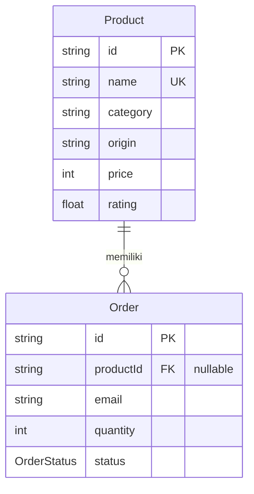

# Dokumen Teknis Modul 6 — PostgreSQL dan Prisma ORM

**Nama/NIM:** Zakiati Latifa / 105224033  
**Repositori:** [zakia04/105224033_Way2Buy](https://github.com/zakia04/105224033_Way2Buy)  
**Tanggal:** 30 Oktober 2026  
**Versi:** Prisma 7.10.1, PostgreSQL, Next.js 16.4.0

> **Status bukti:** skema berhasil divalidasi dan Prisma Client berhasil
> digenerate. Bukti yang membutuhkan koneksi PostgreSQL belum dapat diambil:
> `prisma migrate status` gagal dengan `P1000` (autentikasi ditolak). Bagian
> yang belum dijalankan ditandai jelas; keluaran contoh bukan hasil aktual.

## 1. Rancangan Data



- `Product.id` adalah primary key katalog (`P001`, `P002`, dan seterusnya).
- `Product.name` memiliki unique constraint agar produk bernama sama tidak
  tercatat dua kali; pelanggaran diterjemahkan menjadi `P2002`.
- `Order.id` adalah primary key dan ID publik permintaan.
- `Order.productId` adalah foreign key nullable. Pesanan produk katalog
  merujuk ke satu produk; permintaan `custom` tidak memiliki relasi produk.
- Indeks pesanan ada pada `email`, `productId`, dan `createdAt`.
- Alamat tujuan disimpan sebagai `destinationCiphertext`,
  `destinationIv`, dan `destinationAuthTag`, bukan teks biasa.

Relasi memakai `onDelete: Restrict` untuk mencegah produk dihapus saat masih
dirujuk pesanan. Ini mempertahankan konteks katalog pada riwayat transaksi dan
menghindari penghapusan riwayat secara cascade. Pesanan terkait harus dikelola
lebih dahulu. `onUpdate: Cascade` menjaga foreign key tetap konsisten jika ID
produk diperbarui.

## 2. Skema dan Migrasi

Isi [`prisma/schema.prisma`](../../prisma/schema.prisma):

```prisma
generator client {
  provider = "prisma-client"
  output   = "../generated/prisma"
}

datasource db {
  provider = "postgresql"
}

enum OrderStatus {
  PENDING
  PROCESSING
  COMPLETED
  CANCELLED
}

model Product {
  id           String   @id
  name         String   @unique
  category     String
  origin       String
  price        Int
  rating       Float
  illustration String
  description  String
  createdAt    DateTime @default(now())
  updatedAt    DateTime @updatedAtv
  orders       Order[]
}

model Order {
  id                    String      @id
  customerName          String
  email                 String
  phone                 String
  productName           String
  productId             String?
  quantity              Int
  notes                 String
  destinationCiphertext String
  destinationIv         String
  destinationAuthTag    String
  status                OrderStatus @default(PENDING)
  createdAt             DateTime    @default(now())
  updatedAt             DateTime    @updatedAt
  product               Product?    @relation(fields: [productId], references: [id], onDelete: Restrict, onUpdate: Cascade)

  @@index([email])
  @@index([productId])
  @@index([createdAt])
}
```

Folder migrasi:

```text
prisma/migrations/
├── migration_lock.toml
└── 20261030100000_init/
    └── migration.sql
```

Potongan [`migration.sql`](../../prisma/migrations/20261030100000_init/migration.sql):

```sql
CREATE UNIQUE INDEX "Product_name_key" ON "Product"("name");
CREATE INDEX "Order_email_idx" ON "Order"("email");
CREATE INDEX "Order_productId_idx" ON "Order"("productId");
CREATE INDEX "Order_createdAt_idx" ON "Order"("createdAt");
ALTER TABLE "Order"
  ADD CONSTRAINT "Order_productId_fkey"
  FOREIGN KEY ("productId") REFERENCES "Product"("id")
  ON DELETE RESTRICT ON UPDATE CASCADE;
```

Verifikasi lokal yang berhasil: `npx prisma validate` dan
`npm run db:generate`. Migrasi belum diterapkan: `npx prisma migrate status`
gagal dengan `P1000`. Karena itu, belum ada keluaran aktual `psql \d` atau
tangkapan layar indeks/foreign key. Sesudah `.env` diperbaiki dan migrasi
berhasil, ambil tangkapan terminal dari:

```sql
\d "Product"
\d "Order"
```

## 3. Seed dan Prisma Client

[`prisma/seed.ts`](../../prisma/seed.ts) menggunakan `upsert` untuk enam
produk, dengan `id` sebagai kunci pencarian. Data yang sama dapat di-seed
berulang tanpa menambah baris duplikat. Seed didaftarkan pada
[`prisma7.config.ts`](../../prisma7.config.ts) dengan perintah `tsx
prisma/seed.ts`.

Perintah yang diminta:

```powershell
npx prisma db seed
npx prisma db seed
```

**Hasil aktual:** kedua eksekusi belum dapat dilakukan karena autentikasi
database ditolak (`P1000`). Jika berhasil, implementasi mencetak
`Seed berhasil: 6 produk disinkronkan.` pada setiap eksekusi. Kalimat ini
adalah keluaran yang diharapkan dari kode, bukan bukti bahwa seed sudah
dijalankan dua kali.

Seed tidak mengimpor [`lib/prisma.ts`](../../lib/prisma.ts) karena helper itu
ditujukan untuk request server Next.js, mengimpor `server-only`, dan memakai
singleton global. Skrip seed berjalan mandiri, membuat `PrismaClient` dan
adapter PostgreSQL sendiri, lalu memanggil `$disconnect()` agar proses CLI
berakhir dengan bersih.

## 4. Operasi CRUD

Halaman admin produk ada di `/admin/produk`. Mutasi katalog dan operasi admin
pesanan dilindungi `ADMIN_API_TOKEN` melalui header Bearer. Katalog publik
dibaca oleh Server Component; pesanan baru dibuat oleh formulir pelanggan.
Endpoint admin tidak mengembalikan data alamat terenkripsi.

| Entitas | Aksi/halaman | Metode Prisma | Galat yang ditangani |
| --- | --- | --- | --- |
| Product | Baca katalog dan daftar admin | `product.findMany` | Galat DB dicatat; respons 500 tanpa detail internal. |
| Product | Tambah di `/admin/produk` | `product.create` | `P2002` → 409, nama sudah dipakai; validasi → 400; token hilang/tidak valid → 503/401. |
| Product | Ubah di `/admin/produk` | `product.update` | `P2025` → 404 jika record sudah hilang; `P2002` → 409. |
| Product | Hapus di `/admin/produk` | `product.delete` | `P2025` → 404; `P2003` → 409 jika masih direferensikan (`RESTRICT`). |
| Order | Buat dari `/titip` | `product.findUnique`, `order.create` | Validasi → 400; produk tidak tersedia → 404/409; konflik ID → 409. |
| Order | Baca daftar admin | `order.findMany` | Token wajib; galat DB → 500. |
| Order | Perbarui status admin | `order.update` | `P2025` → 404; status tidak valid → 400. |
| Order | Hapus admin | `order.delete` | `P2025` → 404. |

Formulir admin menampilkan pesan `Nama produk sudah digunakan (P2002).` dan
`Produk tidak ditemukan atau sudah dihapus (P2025).`. Tangkapan layar kedua
pesan belum tersedia karena database tidak dapat diautentikasi. Untuk
menghasilkan bukti: buka `/admin/produk`, masukkan token admin, kirim nama
produk yang sudah ada, lalu uji pembaruan terhadap record yang dihapus dari
sesi admin lain sebelum formulir disimpan.

## 5. Transaksi dan Rollback

[`prisma/verify-transaction.ts`](../../prisma/verify-transaction.ts)
membandingkan kegagalan tanpa transaksi dan rollback:

1. **Tanpa transaksi:** skrip membuat produk dan pesanan melalui operasi
   terpisah, lalu mencoba menghapus produk. Foreign key menolak penghapusan
   (`P2003`); dua insert yang telah committed tetap ada. Skrip lalu menghapus
   pesanan dan produk secara berurutan untuk membersihkan data uji.
2. **Dengan transaksi:** skrip membuat pasangan produk/pesanan dan mencoba
   menghapus produk dalam interactive transaction. `P2003` menggagalkan
   transaksi sehingga kedua insert ikut rollback.

Jalankan dengan `npm run db:verify-transaction` setelah migrasi. **Belum
dijalankan** karena `P1000`; tidak ada hasil sebelum/sesudah aktual untuk
dilaporkan. Keluaran yang dirancang oleh skrip:

```text
TANPA TRANSAKSI: P2003; product=true, order=true.
TRANSAKSI SEBELUM: product=false, order=false
GALAT: P2003 (foreign key RESTRICT); transaksi dibatalkan.
TRANSAKSI SESUDAH: product=false, order=false
```

## 6. Skenario Uji

Sepuluh skenario berikut mencakup CRUD dua entitas dan aturan relasi.
Skenario database belum dieksekusi; hasil aktual seluruhnya **terblokir
autentikasi PostgreSQL (`P1000`)**. Persentase lulus saat ini adalah
**0/10 (0%)**, bukan klaim bahwa alur telah lulus.

| # | Skenario | Hasil yang diharapkan | Hasil aktual |
| ---: | --- | --- | --- |
| 1 | Baca katalog | Produk terurut berdasarkan ID. | Belum dijalankan — `P1000`. |
| 2 | Buat produk dengan ID dan nama baru | HTTP 201; produk tersimpan. | Belum dijalankan — `P1000`. |
| 3 | Buat produk dengan nama yang sudah ada | HTTP 409; pesan `P2002`. | Belum dijalankan — `P1000`. |
| 4 | Ubah produk dengan ID yang ada | HTTP 200; nilai berubah. | Belum dijalankan — `P1000`. |
| 5 | Ubah produk yang tidak ada | HTTP 404; pesan `P2025`. | Belum dijalankan — `P1000`. |
| 6 | Buat pesanan produk katalog dengan alamat valid | HTTP 200; order tersimpan, alamat ciphertext. | Belum dijalankan — `P1000`. |
| 7 | Baca daftar pesanan tanpa token admin | HTTP 401/503; data tidak dikembalikan. | Belum dijalankan melalui HTTP; pemeriksaan DB belum ada. |
| 8 | Ubah status pesanan dengan ID tidak ada | HTTP 404; pesan `P2025`. | Belum dijalankan — `P1000`. |
| 9 | Hapus produk yang masih dirujuk pesanan | HTTP 409; Prisma `P2003` akibat `RESTRICT`. | Belum dijalankan — `P1000`. |
| 10 | Jalankan skenario `db:verify-transaction` | Tanpa transaksi record tetap ada; transaksi membatalkan keduanya. | Belum dijalankan — `P1000`. |

Pemeriksaan non-database yang berhasil: validasi Prisma, generate Prisma Client,
`npx tsc --noEmit`, ESLint (tanpa error), dan `npm test` (13 tes lulus).

## 7. Kendala dan Penyelesaian

1. **Kredensial PostgreSQL lokal tidak diterima.** `npx prisma migrate status`
   menghasilkan `P1000`. Migrasi, seed dua kali, CRUD melalui UI, pemeriksaan
   `psql`, dan rollback belum dapat dibuktikan. Perbarui `DATABASE_URL` di
   `.env` dengan kredensial database praktikum yang benar, kemudian ulangi
   migrasi dan skenario uji.
2. **`psql` tidak tersedia pada PATH.** Setelah koneksi database diperbaiki,
   instal/aktifkan PostgreSQL client untuk mengambil bukti `\d`; jangan
   mengganti bukti tangkapan terminal dengan output yang dibuat-buat.
3. **Cache Components Next.js aktif.** Konfigurasi route `dynamic` tidak
   kompatibel; data Prisma untuk halaman diletakkan di komponen server yang
   dibungkus `Suspense` sesuai model Cache Components.
4. **Build merekomendasikan pembaruan keamanan Next.js.** Setelah konfigurasi
   Cache Components diperbaiki, kompilasi dan pemeriksaan TypeScript build
   berhasil, tetapi perintah build tetap berhenti pada `SecurityFatalError`
   karena versi Next.js terpengaruh kerentanan yang diketahui. Ditemukan
   worktree lain pada branch `security/next-upgrade-20261029` dengan perubahan
   dependency Next.js ke `16.4.3`; perubahan tersebut belum diverifikasi dan
   tidak disentuh karena sudah ada pekerjaan upgrade setara.
5. **Mutasi belum memakai Server Action.** Implementasi saat ini menggunakan
   Route Handler (`/api/products`, `/api/orders`, `/api/admin/orders`). Dokumen
   ini mencatat perilaku aktual; apabila penilaian mensyaratkan Server Action,
   mutasi perlu dipindahkan dan diuji pada iterasi berikutnya.

## 8. Catatan Pemanfaatan AI

AI digunakan sebagai asisten coding untuk membantu menyusun skema Prisma,
migrasi, seed, endpoint CRUD, pemeriksaan rollback, dan dokumen ini.

- **Alat:** AI assistant menggunakan Copilot SDK di VS Code.
- **Perintah verifikasi utama:** `npx prisma validate`, `npm run db:generate`,
  `npx tsc --noEmit`, ESLint, `npm test`, dan `npx prisma migrate status`.
- **Cara verifikasi:** hasil kode dibandingkan dengan schema/migration SQL,
  hasil TypeScript dan lint, serta test suite. Perintah yang memerlukan
  PostgreSQL dilaporkan belum terverifikasi karena `P1000`; output seed,
  transaksi, tangkapan `psql`, dan CRUD tidak diklaim telah berhasil.
